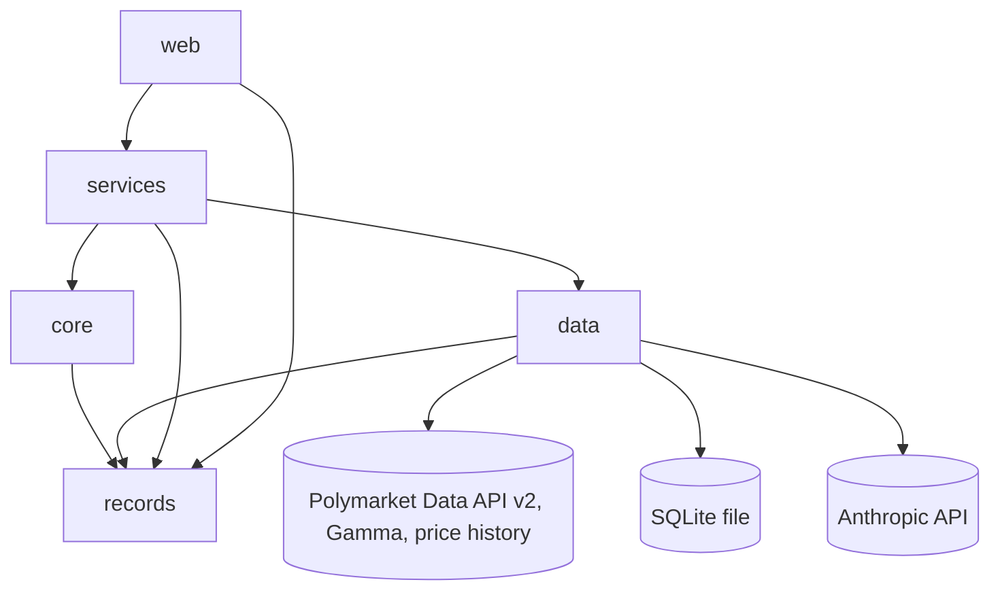
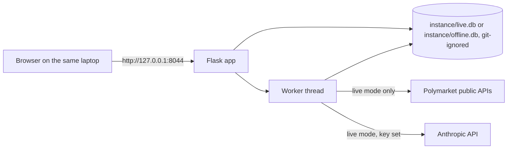
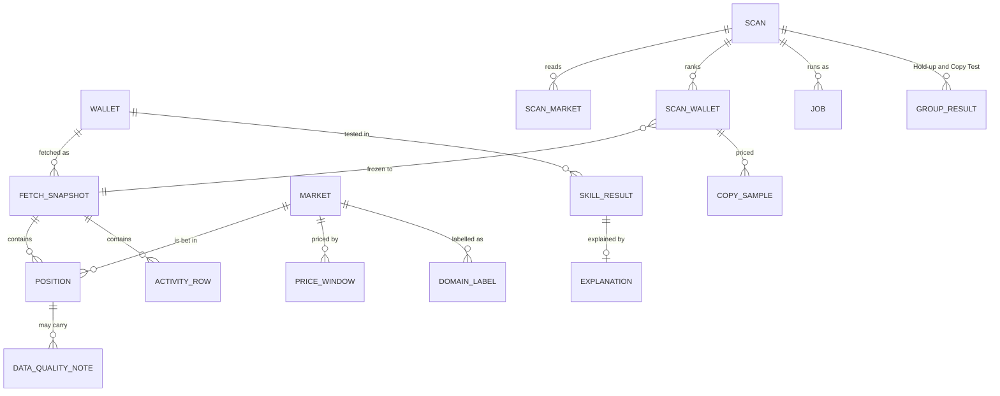

# Architecture Spine — LiquidOracle

## Design Paradigm

One Python program in layers: a **functional core** of pure functions inside an **imperative shell** that does all input and output.

| Layer | Package | Holds |
| --- | --- | --- |
| records | `liquidoracle.records` | The shared record types (`Position`, `ActivityRow`, `Market`, `PricePoint`, …). No app imports |
| web | `liquidoracle.web` | Flask routes, Jinja2 templates, static files (CSS, JS, fonts) |
| services | `liquidoracle.services` | Workflows: fetch, build, test, save; the job worker; the Explanation check |
| core | `liquidoracle.core` | Position building, Skill Test, Hold-up and Copy Test maths, Flags, number phrases. Pure functions |
| data | `liquidoracle.data` | Every outside system: Polymarket client, SQLite store, language model, offline stand-ins |



Arrows are the only allowed imports. `core` imports only `records`, the standard library and numpy.

## Invariants & Rules

### AD-1 — Layer imports point one way, and a test enforces it [ADOPTED]

- **Binds:** all
- **Prevents:** network, database, web or model code leaking into the tested core (PRD s8 Testable core); layers importing each other.
- **Rule:** imports follow the diagram above. One automated test parses every module of every layer and fails on any import the diagram does not allow, including any network, database, web or model library inside `core`.

### AD-2 — One client per outside system, typed records out, read-only [ADOPTED]

- **Binds:** FR-1, FR-2, FR-3, FR-16, FR-18, FR-19, FR-23
- **Prevents:** field or endpoint changes spreading through the code (Data API v1 retires 2026-10-24); a filter silently dropped mid-walk; anything placing orders or holding keys.
- **Rule:**
  - Only `data/polymarket.py` calls Polymarket, with GET requests to public endpoints and no keys. It uses Data API v2, Gamma and the price-history routes (AD-24), never Data API v1.
  - It returns `records` types. Nothing above `data/` sees raw JSON.
  - A cursor walk sends identical parameters on every page, and a test enforces this.
  - Only `data/model.py` calls the language model.

### AD-3 — One shared, locked rate limiter; errors are classified [ADOPTED]

- **Binds:** FR-2, FR-16, FR-17, FR-18; PRD s8 Polite to Polymarket
- **Prevents:** two threads each thinking they are under the limit; a pace above the PRD's limit; unclassified errors reaching a page or killing a job.
- **Rule:**
  - Every Polymarket request passes one process-wide limiter guarded by a lock.
  - The pace is the setting `POLYMARKET_REQUESTS_PER_SECOND`, default 5 `[ASSUMPTION]`. Values above 5 are rejected at startup. (Published limits: docs.polymarket.com/api-reference/rate-limits.)
  - Timeouts, 429, 503, a Gamma or CloudFront 403, and an empty Gamma 404 on a list route (seen during a 2-minute Gamma outage, 2026-10-21) are retried, at most 3 tries in all. When the response carries a `Retry-After` header (a 429 or a 503), the client waits exactly that long instead of its own back-off, because that is what the header asks; otherwise it backs off. Each wait counts as one of the 3 tries. This is the one retry policy for every retried error (Edvard, 2026-10-24). After the third they raise `PolymarketUnavailable`, which stops the job cleanly as `stopped` (resumable, AD-5), so an outage pauses a Scan instead of hanging it. Any other 4xx raises `PolymarketBadRequest` and is logged. (Edvard, 2026-10-23.)
  - A page that times out mid-walk restarts the walk with a smaller `limit`, because the cursor fixes the page size. If that also fails, the read is partial.

### AD-4 — Cache: freshness belongs to a covered range [ADOPTED]

- **Binds:** FR-2, FR-18, FR-19
- **Prevents:** a lookup reusing a Scan's window, or the reverse, and showing a wrong Verdict with 0 network calls; re-fetching data that cannot change.
- **Rule:**
  - Freshness belongs to a snapshot (AD-19). A read is a cache hit only when **one** complete snapshot's own range covers the requested window and was fetched less than 24 hours ago `[ASSUMPTION]`. Rows are never merged across snapshots, and a missing part is never fetched as a gap: the whole window is fetched again. One function in `data/store.py` answers "which snapshot serves this window".
  - When Polymarket does not answer (FR-2), the page offers stored data only from a snapshot whose range matches the view, labelled with its fetch date. Otherwise it says there is no stored data for this view.
  - Gamma Market records, fee schedules and price-history windows never expire once the Market is resolved. Records of open Markets expire with the Wallet lists.
  - Domain labels are keyed by (Market, label source) (AD-16).

### AD-5 — Background work: one worker thread, lookups first [ADOPTED]

- **Binds:** FR-1, FR-2, FR-16, FR-17, FR-18
- **Prevents:** a 70-minute Scan inside a web request; a lookup waiting behind a Scan; two workers on one job; a crash that resumes for ever.
- **Rule:**
  - **Jobs.** A lookup that needs a fetch, and a Scan, are `job` rows. Starting one inserts the row (`queued`) and returns, and the page polls `GET /jobs/<id>/progress`.
  - **One thing at a time, lookups first.** One worker thread does the work. Between any two units of a Scan's work (one Market-list page, one Wallet fetch, one price request) it runs any waiting lookup first, then continues the Scan.
  - **Claiming.** The worker claims a job with one atomic `UPDATE … SET status='running' WHERE id=? AND status='queued'` and checks that `rowcount == 1`.
  - **Phases.** A Scan job runs ranking, Skill Tests, Hold-up Test and Copy Test as phases. The progress JSON carries `phase`, and a Scan counts as finished only when every phase is done.
  - **States.** `queued`, `running`, `done`, `interrupted` (app closed), `stopped` (Polymarket did not answer; Resume offered), `failed` (unexpected error, logged; no Resume). At startup, a job left `running` becomes `interrupted`.
  - **Where it starts.** The worker is a daemon thread started only by `liquidoracle run` (AD-23), never by the app factory.

### AD-6 — SQLite access rules [ADOPTED]

- **Binds:** all that store data
- **Prevents:** "database is locked" and SQLITE_BUSY between the worker and page reads; uncontrolled schema drift.
- **Rule:**
  - Plain `sqlite3`, no ORM. WAL mode, a busy timeout, one connection per thread.
  - Every write transaction starts with `BEGIN IMMEDIATE` and stays short.
  - The schema lives in one `schema.sql`, and its version is `PRAGMA user_version`. On a version mismatch the cache tables are rebuilt; Scans, Watchlists, results, and every snapshot a Scan or result refers to, are migrated and kept. Such snapshots are never pruned. A Scan whose snapshots are gone anyway shows "data rebuilt, cannot resume".
  - Only `data/store.py` runs SQL.

### AD-7 — "Resolved", and before or after the Cut-off Date, come from Gamma and the Wallet's own buys [ADOPTED]

- **Binds:** FR-3, FR-16, FR-17, FR-18
- **Prevents:** Positions on the wrong side because v2's `last_event_at` is the Wallet's last event (0 to 85 hours after resolution); fetch bounds that drop only late-redeemed winners; 50-50 Markets distorting results.
- **Rule:**
  - **Resolved.** A Market is resolved when Gamma says it is closed, its outcome prices are exactly {0, 1}, and it has a `closedTime`. Anything else is left out as "unclear resolution" (AD-11).
  - **The Cut-off Date** means 00:00 UTC on that date, converted in one place.
  - **Before part:** Positions whose Market resolved before the cut-off. **After part:** Positions whose first buy (activity rows) is on or after it, and whose `first_entry_at` in the positions list is not before it. Both are checked because an activity read that starts at the cut-off cannot see older buys (found in the Sample Dataset capture, 2026-10-23: 165, 46 and 20 tokens of three capped Wallets looked new but were first bought before the date).
  - **The window's unit** is "Positions in resolved Markets", countable at fetch time. A fully sold Position is an exclusion inside the window (AD-11), not outside it.
  - **Fetching the before part.** Read the OPEN list in full. Read CLOSED newest-first by `TIMESTAMP` with no `end` bound, and stop when a page's oldest `last_event_at` is earlier than the 2,000th-latest resolution time collected.
  - **Fetching the after part.** Read activity oldest-first from the cut-off until 2,000 Positions in resolved Markets have their first buy.
  - **Activity covers the whole window.** Once the window is chosen, its activity read runs from the earliest Gamma start date among its Markets to the latest `closedTime` among them (no fill can come after resolution), so every buy and sell of every Position in the window is read.
  - The per-Wallet activity read has one cap, the setting `ACTIVITY_ROW_CAP` `[ASSUMPTION]`. On a cap, exactly the Positions whose Market `closedTime` lies after the last row read are left out (AD-11).

### AD-8 — Big Wallets: a window of 2,000 Resolved Positions on each side, capped before exclusions [ADOPTED]

- **Binds:** FR-1, FR-11, FR-16, FR-17
- **Prevents:** Scan, lookup and Hold-up Test capping differently; counts with two denominators.
- **Rule:**
  - Before part = the latest 2,000 Resolved Positions before the cut-off, by resolution time. After part = the first 2,000 after it, by first-buy time. A lookup with no cut-off = the latest 2,000 overall. `[ASSUMPTION: 2,000]`
  - One client function implements this: `positions_near(wallet, cutoff, side, limit)`.
  - The cap applies first, then exclusions (AD-11).
  - When the cap applies, the Verdict card says the result rests on a window: "latest 2,000" for the before part and lookups, "first 2,000" for the after part. A `scan_whole` result (AD-22) says it rests on both windows, and that Positions bought before the cut-off and resolved after it are in neither.

### AD-9 — Scan candidates come only from complete Market reads, sorted by time [ADOPTED]

- **Binds:** FR-16, FR-17
- **Prevents:** survivor bias returning through a profit sort, a capped read or a partial read (time order follows outcome: a winner's last event is its redemption); a Wallet silently skipped.
- **Rule:**
  - For each Market in the Scan's set (AD-21), candidates are the union of `/v2/positions?condition=…` with `status=CLOSED` and with `status=OPEN`.
  - The client function for Market-anchored lists takes no sort argument and always sends `sort_by=TIMESTAMP&sort_direction=ASC`. A test fails if a Market-anchored request is built otherwise.
  - A Market read has a row cap, the setting `MARKET_ROW_CAP` `[ASSUMPTION]`. A read that is partial (timed out after AD-3's retries, or capped) contributes no candidates. It is stored and shown as "not used: partial", the Scan page says "N of 100 Markets used", and the Scan goes on.
  - A Wallet whose read gets `PolymarketBadRequest` or hits a cap is kept and flagged "not fully read". Its unread Positions are left out with a stored reason (AD-11). The flag travels with the Wallet everywhere it is counted: Scan ranking, Watchlist row, Passers, Hold-up groups, Copy Pool. Every group result shows how many of its Wallets are not fully read.
  - A candidate that `/v2/positions?user=` refuses as a protocol contract address (400, "protocol contract address") is one of Polymarket's own contracts, not a trader. It is dropped from the candidates and counted in the Scan record, not flagged "not fully read" (found in the Sample Dataset pick, 2026-10-21; Edvard, 2026-10-23).
  - Only `PolymarketUnavailable` stops the job (`stopped`, resumable). A Wallet is never skipped silently.

### AD-10 — One source per number

- **Binds:** FR-3, FR-4, FR-11, FR-16, FR-18, FR-22
- **Prevents:** a number changing because two builders read it from different places; unredeemed losers getting 0 shares.
- **Rule:**

| Number | Only source |
| --- | --- |
| Which Positions exist, Entry Price, shares bought | positions lists (`/v2/positions`, CLOSED and OPEN) |
| Shares held at resolution | activity rows: Σ buys − Σ sells per token. REDEEM rows are never a share source |
| First-buy time, Own Fees, splits, merges, conversions, sells, buy-to-sell times (FR-22) | activity rows (`/v2/activity`, types TRADE, REDEEM, SPLIT, MERGE, CONVERSION, `start` sent explicitly, `limit` always sent; `is_combo` rows dropped) |
| Resolution, resolution time, fee schedule, outcomes, Market start date | Gamma Market data |
| Copy Test prices | price history (AD-24) |
| Exit PnL; Copy Test fills (each buy fill is copied at its own time + Copy Delay, and Follower PnL sums over fills) | activity rows |

### AD-11 — Exclusions are counted, stored with values, applied the same on both sides, and reported together

- **Binds:** FR-3, FR-11, FR-17
- **Prevents:** a Verdict quietly built on part of a Wallet; the Hold-up Test comparing different kinds of Positions before and after the cut-off; a wrong share count entering the Skill Test looking normal.
- **Rule:**
  - **One builder.** `core/positions` is the only code that builds Positions and applies exclusions. Lookup, Scan, Hold-up Test and Copy Test all call it. It returns the window size, the excluded count for each reason, and the tested count, and pages print only from that record.
  - **Reasons.** A Position is left out of the Skill Test, with one stored reason, when it is:
    - fully sold before resolution (PRD FR-3);
    - in a Market where the Wallet did a SPLIT, MERGE or CONVERSION;
    - a token found only in activity rows;
    - one whose shares held are not explained: not within 0 < s ≤ shares bought;
    - unread, because the Wallet's read was capped or refused (AD-7, AD-9);
    - one whose share gap between positions list and activity is above 1% `[ASSUMPTION]` (the gap's size is stored, so the line can move without refetching);
    - in a Market with unclear resolution (AD-7).
  - **Both sides.** The same rules apply before and after the cut-off.
  - **Thresholds.** The 30 minimum, Minimum After-bets, the Copy Pool and the 10% rule all use the tested count.
  - **The note.** When more than 10% `[ASSUMPTION]` of the Positions in the window are left out, for any of these reasons together, the Verdict says plainly that only part of the Wallet's activity was judged.

### AD-12 — Own Fees come from activity rows, checked against the Market's own schedule

- **Binds:** FR-4, FR-5
- **Prevents:** using v2's `entry_fees_usdc` (wrong in 3 of 7 checks); a wrong fee counted as real; a bad fee knocking a sound Position out of the Skill Test.
- **Rule:**
  - Own Fee per fill = cash paid − shares × price (v2 activity equals v1 trade rows on all 25 fee fills checked), read only in Markets with fees enabled.
  - Each fee is checked against that Market's Gamma `feeSchedule` (rate and exponent) with a rounding tolerance. A maker fill's fee of 0 passes.
  - A fee that fails the check is stored with its value as a data-quality note. Its Position stays in the Skill Test, the fee counts as 0 in Real PnL and in the Scan ranking, and the Verdict card shows how many fees were left out and their recorded total.
  - Fees shift Real PnL and every Simulation equally, so the p-value and Verdict do not depend on this (PRD FR-5).

### AD-13 — Modes are swaps, set once at startup [ADOPTED]

- **Binds:** FR-14, FR-15, FR-19, FR-23
- **Prevents:** scattered `if offline:` checks; Offline Mode calling Anthropic because a key is in `.env`; sample data and live data mixing.
- **Rule:**
  - One settings object is built at startup, then frozen. Priority: command-line flag, then `.env`, then the default.
  - Offline Mode (`--offline` or `OFFLINE=true`) gives services an `OfflineClient` serving the Sample Dataset, and `TemplateModel` plus stored labels whatever the key, with its own database file `instance/offline.db`. Live runs use `instance/live.db`.
  - Mock LLM Mode (no `ANTHROPIC_API_KEY`, or `--mock-llm`) gives `TemplateModel`.
  - Nothing else branches on a mode, and `core` receives no settings.
  - The page shows each mode: the Offline pill, the "Template text" tag on Explanations, and a tag on the Domain table naming the label source actually shown.

### AD-14 — The Sample Dataset is serialized client records, loaded through the normal pipeline [ADOPTED]

- **Binds:** FR-12, FR-13, FR-14
- **Prevents:** offline data taking a different code path from live data; the generator and the loader disagreeing; a repository that needs Git LFS.
- **Rule:**
  - The Sample Dataset is plain JSON files of `records` types, written by one serializer.
  - The Synthetic Wallet generator (FR-13) writes fills (activity rows) first and derives every other list from them with the same serializer. It uses its own fixed constant, not the `SEED` setting. Large synthetic groups (the 1,000 coin-flippers) are regenerated by `load-sample` into `instance/` (git-ignored), not committed.
  - Every tested synthetic Position has its own Market. The Synthetic Wallets that FR-16 expects on the offline Watchlist also hold one small, fully sold Position in each of a fixed set of synthetic anchor Markets with high volume inside the default funnel window, so the normal funnel (AD-21) finds them while AD-11 keeps those Positions out of every Skill Test. No offline branch.
  - `liquidoracle load-sample` always writes `instance/offline.db`, whatever the flags, and runs the normal fetch pipeline with `OfflineClient`. A round-trip test checks that generator → `OfflineClient` → pipeline → offline Scan gives the intended bets, Verdicts and FR-16 Watchlist.
  - Price history is stored as one short window per buy fill, [t − 2 min, t + 32 min], merged where they overlap. Fetching packs the windows of one token into requests of at most 14 days, storing only the points inside the short windows (measured: 1.06 requests per token, the same as the spike's per-outcome estimate; one request per window would be 3.9).
  - A test fails if the committed Sample Dataset exceeds 25 MB `[ASSUMPTION]`. No Git LFS.
  - The committed Sample Dataset is rebuilt by one script from the raw capture (kept outside the repository, `spike/FINDINGS.md`), never trimmed by hand, so the trim is repeatable and reviewable. (Edvard, 2026-10-23.)

### AD-15 — Randomness comes from an explicit Seed, independent of order [ADOPTED]

- **Binds:** FR-5, FR-7, FR-13, FR-18
- **Prevents:** results that cannot be repeated; one Wallet's draws depending on which Wallets came first or on database row order.
- **Rule:**
  - `core` sorts Positions by (`condition_id`, `token_id`) and Wallets by address before any draw.
  - Each random unit gets its own generator from `numpy.random.SeedSequence(SEED, spawn_key=core.rng.spawn_key(purpose, id))`. That one function maps a purpose to a fixed integer code and an id to `int.from_bytes(sha256(id)[:8])`; Python's `hash()` is never used. The random unit of a single-Wallet test is the Wallet; the unit of a group test (Hold-up, Random Group Check) is the test itself, so all its Wallets share the per-Market draws of AD-20. The `random` module and numpy's global state are never used.
  - An FR-7 test runs the same test in two subprocesses with different `PYTHONHASHSEED` values and requires identical results.
  - `SEED` is a setting with one fixed default integer `[ASSUMPTION]`. Every stored result stores its Seed, and every results page (Verdict, Scan, Hold-up Test, Copy Test) shows it.

### AD-16 — The language model sits behind one interface; labels are stored, never silently redone [ADOPTED]

- **Binds:** FR-15, FR-19, FR-20, FR-23, FR-24
- **Prevents:** reruns giving different labels (Haiku 5.5 rejects `temperature 0`); keyword labels and model labels mixing; a test that tunes itself to its labels.
- **Rule:**
  - **Interface.** `data/model.py` has one interface (classify a Market, write an Explanation), implemented by `AnthropicModel` and `TemplateModel`.
  - **Model.** The setting `LLM_MODEL`, default `claude-haiku-5-5`, pinned as written, with `effort` set to `low` and stored with the model ID.
  - **Labels.** Structured outputs limited to the fixed Domain list. Labels are compared case-insensitively and stored under the canonical name, keyed by (Market, source), where the source is a model ID or `keyword-rules`. They are reused, and classifying again is an explicit action.
  - **The gate.** The FR-19 hand labels are made blind (Edvard sees only the 50 questions: no keyword label, model label or category field) and committed before either labeller runs on those 50, and never edited (Edvard, 2026-10-24). The 80% check applies to a real model: if it fails, the model setting is raised and the check re-run, and both results are logged. Keyword rules are checked on other Markets than the 50 hand-labelled ones.
  - **The FR-24 check** runs in `services` on every Explanation from either implementation.

### AD-17 — Tests run network-blocked, and CI proves the README [ADOPTED]

- **Binds:** all; PRD s8 Runs on Windows, macOS and Linux, Runnable from the README
- **Prevents:** a test that quietly calls Polymarket; an offline claim proven only on one laptop; a README that drifted from reality.
- **Rule:**
  - `pyproject.toml` sets `addopts = "--disable-socket"`, so every test runs with sockets blocked. Tests that go online live in `tests/online/`, are marked, and never run in CI.
  - GitHub Actions runs `uv sync --locked` then `uv run pytest` on every push, on Windows, macOS and Linux × Python 3.12 and 3.14.
  - One more job runs the README's three commands as shell steps on a fresh checkout, then requests one Sample Wallet's Verdict page and checks its expected Verdict text.
  - `.python-version` names the Python that `uv` installs.
  - Checks that repeat a whole test 1,000 times (FR-5 coin-flippers, FR-17 and FR-18 planted runs) are marked `slow`. They run in full once per push on Linux with Python 3.14; the other five jobs run the same checks with 100 repetitions. Only the number of repetitions drops: each test still uses 10,000 Simulations, and the determinism checks run unchanged on every job (same Seed gives identical results; two `PYTHONHASHSEED` subprocess runs agree; and a stored golden result, the exact count of Simulations at or above the Real PnL for fixed Wallets and a fixed Seed, is reproduced on every system). Why: float ordering is exactly what differs between systems (the tie bug), so every system must prove it matches. (Edvard, 2026-10-24.)

### AD-18 — Pages are server-rendered; JavaScript only enhances [ADOPTED]

- **Binds:** FR-8, FR-9, FR-16; UX accessibility rules
- **Prevents:** a page that is blank without JavaScript; a build step; headlines that change per machine or go blank.
- **Rule:**
  - Flask renders every page with Jinja2, and the luck chart is server-rendered SVG. Every page is complete without JavaScript.
  - Plain JavaScript files in `web/static/js/` only enhance: `theme.js`, `chart.js` (build-up, explore, marker), `copy-address.js`, `progress.js` (job and lookup progress, tab title, favicon ring). No Node, no bundler. The README lists each file and what it does.
  - The serif is IBM Plex Serif, served unchanged: static WOFF2 at 600 and 700, with the OFL licence file beside them. It is served locally with `font-display: swap` and followed by the system serif stack from DESIGN.md.

### AD-19 — Wallet data is fetched as complete snapshots, and a Scan freezes its snapshots

- **Binds:** FR-2, FR-16, FR-17, FR-18
- **Prevents:** a half-finished fetch passing as fresh; a web lookup and the worker writing the same Wallet twice (identical rows are separate fills and can never be de-duplicated); Hold-up and Copy Test of one Scan resting on different data.
- **Rule:**
  - Each Wallet fetch writes a snapshot with a `fetch_id` that becomes visible in one final step, and readers see only complete snapshots.
  - A per-Wallet lock, shared by web threads and the worker, allows one fetch of a Wallet at a time.
  - A Scan stores the `fetch_id` it used for each Wallet and an as-of time. Resume, Hold-up Test and Copy Test read only those snapshots and ignore anything resolved after the as-of time.

### AD-20 — Correlated bets share their random draw; what cannot be detected is measured and shown

- **Binds:** FR-5, FR-17, FR-18, FR-20
- **Prevents:** fake significance: Passers who bet in the same Markets counted as independent bets (7 Wallets × 40 shared Markets treated as 280 coin flips), a Wallet's two sides of one Market treated as independent, correlated ladder Markets counted as separate evidence, and the Copy Test passing by luck in shared Markets (about 27% instead of 5%).
- **Rule:**
  - **One draw per Market.** In each Simulation, `core/skilltest` draws one uniform U per Market, shared by every Position in that Market across all Wallets in the test. A Position on one outcome wins when U < p of that outcome, and the other side wins when U > 1 − p. Each Position keeps a win chance equal to its Entry Price, so the FR-5 checks are unchanged. The two sides cannot both win when their prices sum to at most 1; above that, the coupling is as tight as the prices allow.
  - **One draw per detectable event.** A negative-risk event (one winner) shares one U, split into disjoint intervals by price. A ladder (same underlying, same resolution date, different thresholds) shares one U with nested intervals ordered by price. Each Market still keeps its own win chance.
  - **The rest is measured.** Every result stores the share of tested Positions whose Gamma event holds another tested Position that is not coupled above, and the Verdict card shows an honesty note above 20% `[ASSUMPTION]`. A planted ladder Wallet has a test.
  - **The Copy Test.** The Copy Test page shows how many of the Passers' Copy Sample Markets are shared by two or more Passers. A planted gate test runs 1,000 Scans in which 10 coin-flipper Passers hold the same side of the same 40 Markets: the Copy p-value may be below 0.05 in at most 7%. If the gate fails, the Random Group Check needs a Market-level null, which is a PRD change.

### AD-21 — The Scan funnel is fixed and shown on the Scan page

- **Binds:** FR-16
- **Prevents:** two stories picking different Markets or ranking on different numbers; a Scan that takes days; a population the user cannot see.
- **Rule:**
  1. **Market set.** Markets resolved in the 90 days before the cut-off, the top 100 by volume `[ASSUMPTION: 90, 100]`, chosen without looking at outcomes and stored with the Scan.
  2. **Candidates** from those Markets (AD-9).
  3. **Shortlist.** 3 × N candidates `[ASSUMPTION]` by a cheap pre-filter on their Market-anchored rows: Σ CLOSED `realized_pnl` + Σ OPEN (resolved value − cost), so unredeemed losers count. The Scan page says the shortlist number is approximate.
  4. **Ranking.** A full fetch of the shortlist, ranked by Real PnL from the AD-10 sources, keeps the top N (default 200).

  The Scan page states the population tested ("Markets resolved in the 90 days before the Cut-off Date, top 100 by volume"), "N of 100 Markets used", the shortlist size, and the Wallets not fully read (AD-9).

### AD-22 — Every result records the Position set it was computed on

- **Binds:** FR-1, FR-8, FR-16, FR-17, FR-20
- **Prevents:** a Watchlist row saying *Skilled* while its Verdict page says *No evidence of skill*; one result shown under another's label.
- **Rule:**
  - Every stored result carries a scope: `lookup` (latest 2,000), `scan_whole` (both fetched windows: the Watchlist, PRD Glossary), `scan_before` (the Passers) or `holdup_after`. A Domain result's scope is its base set plus the Domain, e.g. `scan_whole/domain:crypto`, and its key includes the label source. Every result also carries `scan_id`, cut-off, Seed and `fetch_id`.
  - Pages read results by the full key, and every results page names the set it shows. A Verdict page opened from a Scan shows that Scan's result for that scope.

### AD-23 — Serving rules

- **Binds:** PRD s8 Runs locally; SM-2
- **Prevents:** the examiner hitting macOS AirPlay on port 5000; the Werkzeug debugger exposed; a second loader of `.env`.
- **Rule:** `liquidoracle run` binds to 127.0.0.1 only, on the setting `PORT` (default 8044 `[ASSUMPTION]`, not 5000), with debug and the reloader off and `load_dotenv=False`. It is the only place the worker starts (AD-5).

### AD-24 — Price history sits behind one client function and is captured early

- **Binds:** FR-12, FR-18
- **Prevents:** the Copy Test breaking when the old route goes away. `/v2/prices-history` replaced the CLOB route on 2026-09-04 and keeps 1-minute data for at least 7 days only. The CLOB route still answers, with no end date announced, and v1 got three days' notice.
- **Rule:**
  - One client function returns price points for a token and window, from the CLOB route while it answers with 1-minute data, else from `/v2/prices-history` with `bucket_seconds=60` sent explicitly. It never silently substitutes a coarser grain.
  - One pure rule `price_at(points, t)` gives the last point at or before t, at most 2 minutes old, live and offline.
  - Fetched windows never expire (AD-4). The Sample Dataset's windows are fetched as early as possible.
  - Online, a buy with no 1-minute price is left out of that Copy Delay and counted (FR-18).
  - **Daily route check** (Edvard, 2026-10-24): a scheduled GitHub Actions workflow makes one plain GET a day to the old route, with no keys, for a fixed resolved token and window, and classifies the answer (one-minute points, coarser points, no points, or an error after retries). It alerts only when the classification changes from the last run. If the course organisation blocks Actions, a local scheduled task runs the same check, and how this was found out is logged.
  - **Insurance pool** (Edvard, 2026-10-24): 50 Wallets for the default Cut-off Date, picked by a rule committed before the run (`spike/INSURANCE-RULE.md`), with every buy fill's price window in their first 2,000 after-part Positions, captured while the old route answers and kept outside the repository. If the old route is gone when the real-data Copy Test runs, the Copy Test runs on this frozen pool as a reduced test, with its limits stated (PRD FR-18).

### AD-25 — Number phrases have one home

- **Binds:** FR-8, FR-9, FR-16, FR-18, FR-24
- **Prevents:** the template and the FR-24 check phrasing the same p-value differently, so correct Explanations get replaced.
- **Rule:**
  - Every user-facing number phrase ("about 1 time in 300", "fewer than 1 time in 10,000", the Copy Test phrase, Minimum Luck Passes, money with "−") comes from one pure module, `core/phrases.py`, used by templates, the FR-24 check and the tests.
  - Domain Verdict phrases use the Bonferroni-adjusted p-value (FR-20).
  - `core` returns the chart bins and the exact count for the marker sentence, and a result stores them outright.

## Consistency Conventions

| Concern | Convention |
| --- | --- |
| Domain names in code | The PRD Glossary terms: `Wallet`, `Market`, `Position`, `ResolvedPosition`, `SkillResult`, `Scan`, `Watchlist`, `CopySample`. Python `snake_case` for modules and functions. |
| Identifiers | Wallet = proxy-wallet address, lower-case `0x…` (FR-1). Market = `condition_id` hex string. Outcome = `token_id` string. |
| Time | UTC epoch seconds (`int`) everywhere inside the app. Gamma's ISO strings are converted in `data/`. The Cut-off Date is 00:00 UTC (AD-7). Dates are formatted only for display. |
| Money | USD as `float`. Rounded to cents only for display. Tests compare to the cent (absolute tolerance 0.005). **Exception, the Skill Test's comparison:** each Position's win and loss amounts are rounded to whole cents once, and Real PnL and every Simulation sum those integers, so a Simulation equal to the Real PnL counts as a tie exactly. Float sums in different orders differ by tiny amounts and miss ties (found 2026-10-21: p ≈ 0.74 came out as 0.0002). A test: a Wallet whose bets all won at prices near 1 gets a p-value close to the product of its prices. (Edvard, 2026-10-23.) |
| Errors | `data/` raises typed errors (`PolymarketUnavailable`, `PolymarketBadRequest`, `NotAvailableOffline`, `ModelUnavailable`). `services/` turns them into the messages in EXPERIENCE.md. Pages never show a raw exception. |
| Job progress | `GET /jobs/<id>/progress` returns JSON `{status, phase, done, total, message}`. It is the only contract between the worker, the pages and `progress.js`. |
| Settings | Read once into a frozen settings object and passed down, never read from the environment deep in the code. `.env.example` lists every key. |
| Logging | Standard `logging` to the console. Never log the API key. |
| Requirement tracing | Each test names its FR or AD in its docstring or marker. |
| Banned and avoided words | One list in `services`: PRD s8's banned words plus EXPERIENCE.md's avoided words, with the allowed exceptions written next to them. Used by the FR-24 check and by a test over every template and fixed text. |

## Stack

| Name | Version |
| --- | --- |
| Python | >= 3.12 (CI: 3.12 and 3.14; `.python-version` committed) |
| uv (install and run, `uv.lock` committed) | 0.13.4 |
| Flask (with Jinja2) | 3.1.3 |
| requests | 2.34.2 |
| numpy | 2.5.4 |
| anthropic (Python SDK) | 1.17.0 |
| python-dotenv | 1.2.4 |
| SQLite | Python standard library `sqlite3` |
| pytest | 9.1.1 |
| pytest-socket | 0.8.1 |
| GitHub Actions: setup-uv, checkout | v10.3.0, v7.0.1 |
| Language model | `claude-haiku-5-5` |
| IBM Plex Serif (static WOFF2) | @ibm/plex-serif 2.0.0 |
| Polymarket APIs | Data API v2, Gamma, CLOB `/prices-history` and `/v2/prices-history` |

## Structural Seed

```text
G44-tokle/
  src/liquidoracle/
    __main__.py        # flags, settings, commands: run, load-sample, make-synthetic
    settings.py        # frozen settings (AD-13)
    records.py         # shared record types (AD-1)
    web/               # Flask app factory, routes, templates/, static/{css,js,fonts}/
    services/          # lookup, scan, holdup, copytest, jobs (worker), explanation check
    core/              # positions, skilltest, holdup, copytest, flags, phrases (pure)
    data/              # polymarket.py, offline.py, store.py, schema.sql, model.py, synthetic.py
  sample_data/         # Sample Dataset JSON + FR-19 hand labels (AD-14, AD-16)
  tests/               # unit, architecture rules; tests/online/ never runs in CI
  spike/               # data spike and architecture probes (historical, not imported)
  .github/workflows/   # CI (AD-17)
  pyproject.toml  uv.lock  .python-version  .env.example  README.md
```



Deployment: local only, one user, nothing hosted (PRD s8). Secrets: `ANTHROPIC_API_KEY` in `.env`, never committed.



## Capability → Architecture Map

| Capability | Lives in | Governed by |
| --- | --- | --- |
| FR-1, FR-2 lookup and cache | `web`, `services/lookup`, `services/jobs`, `data/polymarket`, `data/store` | AD-2, AD-3, AD-4, AD-5, AD-8, AD-19 |
| FR-3 build Positions | `core/positions` | AD-7, AD-10, AD-11 |
| FR-4 to FR-7 Skill Test | `core/skilltest` | AD-1, AD-12, AD-15, AD-20 |
| FR-8 to FR-11 Verdict page | `web` templates, `core/phrases`, `services/lookup` | AD-8, AD-11, AD-18, AD-22, AD-25 |
| FR-12 to FR-14 Sample Dataset, Synthetic Wallets, Offline Mode | `sample_data/`, `data/offline`, `data/synthetic`, `__main__` | AD-13, AD-14, AD-15, AD-24 |
| FR-16 Scan and Watchlist | `services/scan`, `services/jobs`, `web` | AD-5, AD-9, AD-19, AD-21, AD-22 |
| FR-17 Hold-up Test | `core/holdup`, `services/holdup` | AD-7, AD-8, AD-11, AD-20, AD-22 |
| FR-18 Copy Test | `core/copytest`, `services/copytest` | AD-10, AD-15, AD-19, AD-24 |
| FR-15, FR-19 Domains and Mock LLM Mode | `data/model`, `services` | AD-13, AD-16 |
| FR-20, FR-21 Domain Verdicts and table | `core/skilltest`, `web` templates | AD-20, AD-22 |
| FR-22 Flag | `core/flags` | AD-10 |
| FR-23, FR-24 Explanation | `data/model`, `services`, `core/phrases` | AD-13, AD-16, AD-25 |
| PRD s8 cross-cutting | CI, README, settings, `data/store` | AD-1, AD-3, AD-6, AD-17, AD-18, AD-23; Banned words convention |

## Deferred

| Deferred | Why it can wait |
| --- | --- |
| Rebuilding the true entry price of split, merge and conversion Positions | Needs every trade row; left out and counted instead (AD-11). |
| Table columns in `schema.sql` | The first story that stores each entity defines them, within AD-6, AD-10 and AD-19. |
| Correlation between sibling Markets of one negative-risk event | Stated limit of AD-20; revisit if real data shows it matters. |
| Whether the v2 activity cursor has a depth cap | Untested; `ACTIVITY_ROW_CAP` and AD-11 cover a capped read. |
| A Market-anchored read with `sort_by=TIMESTAMP` | The probes used the default sort; the first data story checks one. |
| `/v2/resolutions` as a fallback for Gamma resolution times | Not yet compared with Gamma; only needed if Gamma fails. |
| Size gaps on v2 | Re-measured while building the Sample Dataset (AD-11). |
| Keyword rules and templates for Mock LLM Mode | Story-level content within AD-16. |
| Hosting, accounts, login | Out of scope (PRD s5, s8). |
